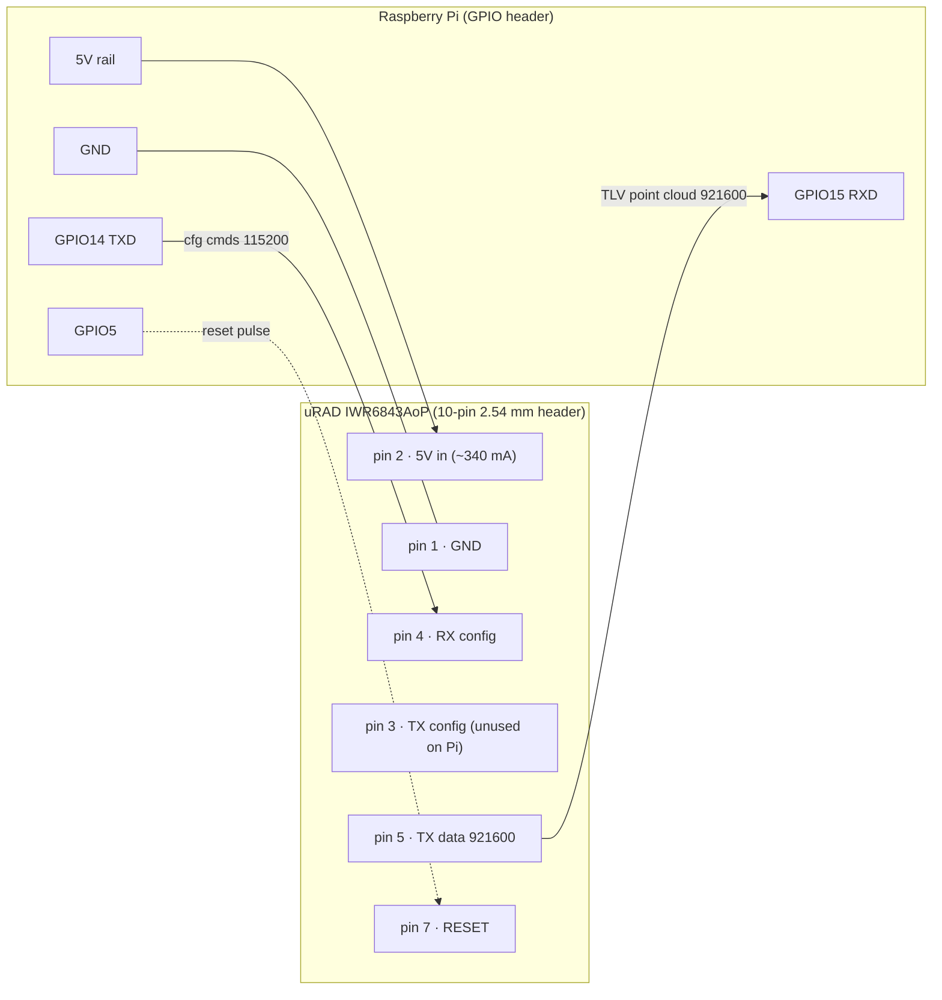

# Research: device drawing format for lares-sense

> Research note (2026-09). This repo has no `docs/research/` convention yet; this
> file starts it. Question: which representation(s) should we adopt for technical
> drawings of the uRAD IWR6843AoP + Raspberry Pi setup so that (a) humans can
> document how it looks today, and (b) future LLM coding agents can **read and
> write/extend** the drawings reliably. Every factual claim below cites its
> primary source. No repo file was modified to produce this note.

## TL;DR (ranked for this repo)

1. **Mermaid `flowchart`/`block` in fenced code blocks** for wiring, pinout and
   block diagrams. GitHub renders it natively in Markdown with zero build step;
   agents write it as plain text. Keep the existing ASCII-art diagrams and
   Markdown pinout tables as the machine-readable source of truth — the Mermaid
   diagram is the rendered projection.
2. **OpenSCAD (`.scad`) for physical geometry** — enclosure, wall mount, board
   standoff positions, orientation. It is text-based parametric 3D CAD an agent
   writes like code; export ASCII STL (GitHub shows STL in an interactive 3D
   viewer, and ASCII STL even renders inside a fenced ```stl``` block in
   Markdown) plus PNG previews for humans who don't open CAD.
3. **Committed SVG as the escape hatch** for anything 2D that Mermaid can't
   express (exact board artwork, annotated photos traced as vectors). GitHub
   displays and diffs SVG files. Author it via agent or a vector editor; treat
   it as a render target, not the primary source, unless hand-crafted.
4. **Do NOT adopt**: image-generation "technical drawings" as documentation
   source (not precisely readable back, not diffable, not deterministic), D2 /
   PlantUML / Graphviz (better languages, but none render natively on GitHub —
   they'd force a build step or an external bridge like Kroki, against repo
   convention), Excalidraw/draw.io (human-nice, agent-hostile verbosity; draw.io
   `.drawio.svg` is the least-bad variant if a GUI editor is ever wanted).

Core principle the combo encodes: **tables + text DSLs are the source of truth;
every pixel humans see is a deterministic projection of them.**

## Comparison table

Scores: ●●● = strong, ●●○ = OK, ●○○ = weak, ○○○ = absent.

| Candidate | A. Agent-writable | B. Agent-readable | C. GitHub zero-build render | D. Physical expressiveness | E. Longevity / tooling risk |
|---|---|---|---|---|---|
| Mermaid | ●●● (line DSL, cheap tokens; typos can break render) | ●●○ (logical structure yes; layout only partially) | ●●● (native in MD files, issues, wikis) | ●○○ (abstract boxes/arrows only) | ●●● (open source, GitHub-supported; version drift exists) |
| D2 | ●●● (clean text syntax, built-in autoformatter) | ●●○ | ●○○ (open feature request; needs CI/Kroki) | ●○○ | ●●○ (single-vendor stewardship; young) |
| PlantUML | ●●○ (Java-graphviz deps, `<>` syntax quirks) | ●●○ | ●○○ (no native render; browser ext / server / Kroki) | ●○○ (UML abstraction) | ●●● (20+ yrs, huge ecosystem) |
| Graphviz DOT | ●●○ (tiny language but rank/layout is opaque) | ●●○ | ●○○ (not native; via Kroki) | ●○○ | ●●● (30+ yrs, AT&T lineage) |
| OpenSCAD | ●●● (real programming language, deterministic) | ●●● (geometry fully reconstructable from code) | ●●○ (`.scad` is viewable text; visuals need exported STL/PNG — both render) | ●●● (true 3D: dimensions, holes, connectors, orientation) | ●●● (mature OSS; no cloud dependency) |
| Raw SVG | ●●○ (writable but verbose; high token cost) | ●●● (explicit coordinates) | ●●● (GitHub displays + visually diffs SVG) | ●●○ (2D only; can draw dimensions/labels) | ●●● (W3C standard, ubiquitous) |
| Excalidraw | ●○○ (JSON, opaque element IDs, absolute coords) | ●●○ (JSON parseable but bloated) | ●○○ (no native render; export needed) | ●●○ (freehand 2D) | ●●○ (active project; format evolves) |
| draw.io XML | ●○○ (XML; style strings cryptic; pages compress by default) | ●●○ | ●●○ via `.drawio.svg` (valid SVG + embedded XML) | ●●○ (2D, stencil-based) | ●●○ (proprietary format, OSS editor) |
| Kroki (bridge) | n/a (renders others' formats) | n/a | ●○○ (needs network/hotlink or CI commit) | n/a | ●●● (MIT, self-hostable) |
| LLM image gen | ●○○ (prompt ≠ precise control) | ●●○ (multimodal vision reads images back, but spatial precision documented as weak) | ●●● (PNG renders anywhere) | ●●○ (looks physical, dimensions unreliable) | ●●○ (model churn; non-reproducible) |

## Per-candidate findings (primary sources)

### 1. Mermaid — recommended for wiring/block diagrams

- GitHub natively renders **mermaid, geoJSON, topoJSON and ASCII STL** fenced
  blocks in "GitHub Issues, GitHub Discussions, pull requests, wikis, and
  Markdown files" — no build step. Source: GitHub docs, *Creating diagrams*,
  https://docs.github.com/en/get-started/writing-on-github/working-with-advanced-formatting/creating-diagrams
  The same page shows the ```` ```mermaid ```` fence and an `info` block to
  check GitHub's Mermaid version.
- Mermaid's syntax reference states the failure mode honestly: "Unknown words
  and misspellings will break a diagram, while parameters silently fail", plus
  known breakers like the word `end` in flowcharts. Source:
  https://mermaid.js.org/intro/syntax-reference.html
- Diagram types cover our needs: flowchart (docs: https://mermaid.js.org/syntax/flowchart.html)
  and block diagrams — "Block diagrams use a different approach. In this
  diagram we give the author full control over where the shapes are
  positioned", with `columns` for grid layout, explicitly pitched at
  "Electrical Systems" use. Source: https://mermaid.js.org/syntax/block.html
- The full type catalogue (flowchart, sequence, class, state, ER, gantt, pie,
  C4, mindmap, packet, …) is in the syntax docs index:
  https://mermaid.js.org/intro/syntax-reference.html and
  https://mermaid.js.org/syntax/all-examples.html
- Agent-fit: line-oriented, human-readable DSL; cost is a few hundred tokens
  per diagram. Determinism is good for structure, weaker for layout
  (auto-layout may move shapes — the `block` type fixes that, per the block
  docs above). No physical geometry, dimensions, or connector pitch — wrong
  tool for mechanical drawings.

### 2. D2 — excellent language, wrong fit for this repo's constraints

- D2 is a text-to-diagram language with a local/offline CLI, VS Code and Vim
  extensions, exports to "SVG, PNG, PDF, PPTX, GIF, and ASCII". Sources:
  https://d2lang.com/ (feature list) — the export claim is on the homepage
  feature grid.
- GitHub does **not** render D2 natively. It is an open feature request at
  GitHub (community discussion https://github.com/orgs/community/discussions/176562),
  and a D2 maintainer stated GitHub client-side rendering means "we won't be
  supported by GitHub until our WASM package is out. And we want to wait til
  1.0" (D2's author in https://github.com/meta/docusaurus/discussions/9608).
- Consequence for us: adopting D2 forces a CI action that renders and commits
  SVGs, or the Kroki bridge — both violate the repo's no-build-step convention.

### 3. PlantUML — mature, but no native GitHub render

- PlantUML's own "Running" page lists its render paths: local jar / command
  line, IDE plugins, the PlantUML server, Docker, and (new) an official browser
  extension that renders PlantUML "directly inside GitHub … No server. No
  tokens." Source: https://plantuml.com/running
- That browser extension is per-viewer client-side tooling — a reader without
  it sees raw text. GitHub's native diagram set remains mermaid/geojson/
  topojson/stl only (GitHub docs, URL in §1).
- Verdict for us: nothing PlantUML does beats Mermaid for our diagram classes,
  and it adds a Java/runtime dependency for local rendering.

### 4. Graphviz DOT — the classic, same rendering gap

- Graphviz is open-source graph visualization: "layout programs take
  descriptions of graphs in a simple text language" and output SVG/PostScript
  etc.; it "was not intended to be a Visio replacement". Source:
  https://graphviz.org/about/
- Abstract node-and-edge graphs only; auto-ranking decides layout. Not native
  on GitHub (see §1). Same conclusion as D2/PlantUML: only via Kroki/CI.

### 5. OpenSCAD — recommended for physical geometry

- OpenSCAD is script-based parametric 3D CAD; the official documentation page
  indexes the language reference, cheat sheet, and the user manual (hosted on
  Wikibooks). Source: https://openscad.org/documentation.html
- It is fully command-line drivable, so agents/humans can render and export
  deterministically: `openscad -o out.stl model.scad` where "the file extension
  specifies the type: stl, off, …, svg, pdf, png, …"; ASCII vs binary STL is
  selectable (`asciistl` / `binstl`). Source (official manual):
  https://en.wikibooks.org/wiki/OpenSCAD_User_Manual/Using_OpenSCAD_in_a_command_line_environment
- Imports STL/OBJ/3MF/SVG/DXF — so a measured reference mesh can be combined
  with parametric code. Source (official manual):
  https://en.wikibooks.org/wiki/OpenSCAD_User_Manual/STL_Import_and_Export
- Human side on GitHub: STL files render in GitHub's interactive **3D File
  Viewer** (spin/zoom; ≤10 MB; invalid or oversized models won't display).
  Source: https://docs.github.com/en/repositories/working-with-files/using-files/working-with-non-code-files#3d-file-viewer
  Additionally, **ASCII STL inside a ```stl fenced block renders as an
  interactive 3D model directly in Markdown** — diagrams-as-code, zero build
  step. Source: https://docs.github.com/en/get-started/writing-on-github/working-with-advanced-formatting/creating-diagrams#creating-stl-3d-models
- Agent-fit: it's a real (small) programming language with modules, variables
  and arithmetic — LLMs already write it well, and there are dedicated agent
  skills for it (see "Installable agent skills" below). Error tolerance: the
  compiler fails loudly on bad geometry/syntax, which is exactly what an agent
  needs (deterministic feedback loop).
- Limits: no freehand 2D illustration; humans must open the STL/PNG (or the
  fenced viewer) rather than "see" the model in the `.scad` text itself. The
  `.scad` source is readable text, though.

### 6. Raw SVG — keep as render target / escape hatch

- GitHub "can display several common image formats, including PNG, JPG, GIF,
  PSD, and SVG" and offers visual diffs (2-up, swipe, onion skin) for them;
  SVGs support no inline scripting/animation on GitHub and may not render in
  Firefox. Source:
  https://docs.github.com/en/repositories/working-with-files/using-files/working-with-non-code-files#rendering-and-diffing-images
- SVG is a W3C standard XML vector format with explicit geometry coordinates
  (spec: https://www.w3.org/TR/SVG/; developer reference:
  https://developer.mozilla.org/en-US/docs/Web/SVG) — so an agent can read it
  back exactly.
- Cost: hand/agent-authoring precise SVG is verbose (hundreds of coordinate
  tokens for anything nontrivial) and easy to make ugly; better generated from
  a structured source (Mermaid CLI, OpenSCAD→SVG export, or a script) than
  freehanded.

### 7. Excalidraw — human-sketch tool, weak as agent medium

- `.excalidraw` files are "plaintext JSON" with an `elements` array (id, type,
  x, y, width, height, …). Source: https://docs.excalidraw.com/docs/codebase/json-schema
- Editing/preview needs excalidraw.com or the VS Code extension
  (https://marketplace.visualstudio.com/items?itemName=pomdtr.excalidraw-editor);
  GitHub does not render `.excalidraw` natively (its native set is §1's four).
- JSON with opaque ids and absolute coordinates means every edit rewrites
  blobs of unreadable elements — bad diffs, high token cost. Fine for humans
  sketching; wrong as agent source of truth.

### 8. draw.io / diagrams.net — the GUI compromise is `.drawio.svg`

- `.drawio` is uncompressed XML (`mxfile` → `mxGraphModel` → flat `mxCell`
  list, parent attribute defines the tree); however "a `<diagram>` may contain
  the same XML as compressed text" (URI-encoded, raw-DEFLATE, Base64), which
  kills diffs unless compression is disabled. Source (official file-format
  wiki): https://github.com/jgraph/drawio/wiki/File-Format
- `.drawio.svg` is "a SVG image; the `<mxfile>` XML is in the `content`
  attribute" — i.e., one file that GitHub renders as an image AND the editor
  re-opens as a diagram (same wiki source, "File types" table).
- The VS Code integration's own README markets exactly our dual use: "`.drawio`
  files are plain XML: they diff cleanly in git, and AI assistants can read,
  edit and review diagram changes like any other code." Source:
  https://github.com/hediet/vscode-drawio
- Still: XML verbosity, cryptic `style` strings, and a proprietary (though
  open-source-editor) format. Adopt only if a human demands GUI editing.

### 9. Kroki — universal render bridge, but an external dependency

- Kroki is "a unified API to create diagrams from" 30+ libraries (includes
  D2, PlantUML, Graphviz, Mermaid, Excalidraw, blockdiag…), callable via
  GET (deflate+base64 URL) or POST with plain text, available as free service
  or self-hosted; MIT-licensed, "never going away; anyone can host this
  service". Sources: https://kroki.io/ and https://docs.kroki.io/
- For this repo it means hotlinked render URLs (external uptime dependency,
  diagram content embedded opaquely in a URL) or a CI step committing renders
  (build step). Both violate convention. Revisit only if we ever adopt D2.

### 10. LLM image generation — render target only, never source of truth

- Generation: GPT Image models "can use text and image inputs to create new
  images or edit them". Source: OpenAI, *Images and vision*,
  https://developers.openai.com/api/docs/guides/images-vision
- Read-back: modern vision-capable models genuinely analyze images — supported
  inputs PNG/JPEG/WEBP/GIF, up to 1,500 images per request; they can "describe
  images, read visible text, and answer questions about objects, shapes,
  colors, or textures". So an agent *can* look at a rendered drawing or photo.
  Same source.
- But the same official page documents the precision limits: "the model
  struggles with tasks requiring precise spatial localization"; "may struggle
  to understand graphs or text where colors or styles … vary"; "Counting: the
  model may give approximate counts"; rotated text may be misread. Same URL:
  https://developers.openai.com/api/docs/guides/images-vision#limitations
  Claude's vision docs mirror this (recommends image input, with
  accuracy/hallucination caveats):
  https://platform.claude.com/docs/en/build-with-claude/vision
- Practical verdict: a generated "technical drawing" is a plausible-looking
  image, not a dimensioned model — pin pitch, header counts and mounting-hole
  positions are exactly the "precise spatial localization / approximate
  counting" category vision models are documented to get wrong. And a
  regenerated image is not byte-reproducible, so it can't be diffed or trusted
  as a source. Use image-gen at most to *illustrate*; store truth as text.

## Installable agent skills (top 3, primary = the repos)

1. **`openscad` skill in mitsuhiko/agent-stuff** (~3.2k★ repo) — "Create,
   validate, and export OpenSCAD 3D models. Supports parameter customization,
   visual preview from multiple angles, and STL export." Tools:
   `preview.sh`, `multi-preview.sh`, `export-stl.sh`, `validate.sh`,
   `extract-params.sh`. Install: `npx skills add mitsuhiko/agent-stuff/openscad`.
   Sources: https://github.com/mitsuhiko/agent-stuff and
   https://agentmods.dev/skills/mitsuhiko/agent-stuff/openscad
   (agent-stuff is built for the Pi coding agent family — best fit for us.)
2. **WH-2099/mermaid-skill** (~299★) — Claude Code skill covering 23 Mermaid
   diagram types; `references/` per type, auto-synced weekly from the official
   mermaid-js docs by a GitHub Action. Plain `SKILL.md` + markdown refs, so it
   drops into any skills-supporting agent (incl. pi). Source:
   https://github.com/WH-2099/mermaid-skill
3. **imxv/Pretty-mermaid-skills** (~1.5k★) — renders Mermaid source to
   themed SVG/PNG/terminal-ASCII locally, no browser; explicit multi-agent
   support (Claude Code, Cursor, Codex, Gemini CLI, Antigravity…). Use when we
   want committed SVG/PNG renders of Mermaid sources. Source:
   https://github.com/imxv/Pretty-mermaid-skills
   (Honourable mention, OpenSCAD: https://github.com/iancanderson/openscad-agent —
   Claude-Code agent environment with iterative render-and-self-correct loop
   and STL printability validation.)

## Ready-to-paste samples (top 2 formats)

### A. Mermaid — Pi↔uRAD wiring (paste into `docs/hardware/`)

Generated from the pinout table in `sensor-reference.md`; table stays canonical.

````markdown

````

Notes: single-UART limitation (no config ACKs while streaming) is documented in
`docs/hardware/esp32-connection.md`; RST-on-GPIO5 convention in
`docs/hardware/sensor-reference.md`. Check GitHub's Mermaid version with an
`info` diagram before using newer types like `block` (GitHub docs, §1).

### B. OpenSCAD — wall-mount bracket sketch (`docs/hardware/enclosure.scad`)

```scad
// Wall mount for uRAD IWR6843AoP + Pi host (dimensions to be measured).
// Render: openscad -o enclosure.stl --export-format asciistl enclosure.scad
wall_t   = 3;    // plate thickness
board_l  = 60;   // TODO measure: uRAD board length
board_w  = 45;   // TODO measure: uRAD board width
hdr_x    = 5;    // TODO measure: 10-pin header inset from board edge
hdr_pitch= 2.54; // header pin pitch (known)
hdr_pins = 10;
standoff= 6;     // board standoff height
hole_d  = 3.2;   // M3 mounting holes

module board_footprint() { cube([board_l, board_w, 1.5]); }

module header() {                  // 2x5? No: 1x10 row, pitch 2.54
    for (i = [0 : hdr_pins - 1])
        translate([hdr_x, i * hdr_pitch, 1.5]) cylinder(d = 2.54, h = 8.5, $fn = 24);
}

module wall_plate() {
    difference() {
        cube([board_l + 20, board_w + 20, wall_t]);
        // four M3 holes at plate corners
        for (x = [10, board_l + 10], y = [10, board_w + 10])
            translate([x, y, -1]) cylinder(d = hole_d, h = wall_t + 2, $fn = 24);
    }
}

module standoffs() {
    for (x = [8, board_l - 8], y = [8, board_w - 8])
        translate([x, y, wall_t]) cylinder(d = 6, h = standoff, $fn = 24);
}

wall_plate();
standoffs();
%translate([10, 10, wall_t + standoff]) { board_footprint(); header(); }
// ^ '%' ghost: shows board+header position in preview, excluded from STL
```

Workflow after editing: export ASCII STL (`--export-format asciistl` per the
CLI manual, §5), commit both files; the STL opens in GitHub's 3D viewer, and
for small models the ASCII STL can additionally be pasted into a ```stl fenced
block inside Markdown (GitHub docs, §1). PNG previews:
`openscad -o preview.png --imgsize=1200,900 --viewall --autocenter enclosure.scad`.

## How agents use this later

1. **Read path (device → understanding):** the canonical truth is
   `sensor-reference.md` pinout table + ASCII diagrams + the `.scad` model. An
   agent answers geometry questions from `.scad` (it's code: grep modules,
   variables, dimensions) and wiring questions from the table. The Mermaid
   diagram and STL/PNG renders are for humans; agents may regenerate them, not
   parse them.
2. **Write path (understanding → device doc):** to change wiring, edit the
   table and the Mermaid block in the same commit (they live in one file; the
   Mermaid is hand-maintained projection). To change geometry, edit
   `enclosure.scad`, run the export command in the file header, commit the
   regenerated ASCII STL/PNG. Both edits are plain-text diffs, reviewable in PRs.
3. **Validation loop:** `openscad validate.sh`-style checks (or plain
   `openscad -o /dev/null` compile) fail loudly on bad geometry; Mermaid breaks
   visibly if syntax is wrong ("unknown words … will break a diagram",
   mermaid.js.org) — so a render check belongs in review, and skills like
   mitsuhiko's openscad or WH-2099's mermaid give the agent the exact tooling.
4. **Photos:** commit real photos as PNG/JPG for ground truth (GitHub renders
   and diffs them, §6); a multimodal agent may consult them for coarse layout,
   but per OpenAI's own limitations list (§10) never trust vision for exact
   dimensions — measure, then write the number into `.scad`/table.
5. **When a diagram type outgrows Mermaid** (e.g. we want D2's aesthetics),
   revisit Kroki or a CI render step — deliberately out of scope while the
   no-build-step convention holds.

## Addendum: radar frame orientation from vendor docs (photo-audit follow-up)

> Radar frame for OUR unit (green "uRAD by Anteral" IWR6843AoP board, s/n
> 2380646A-Y41-250730, on the blue Anteral uRAD IWR-AWR Pi adapter), from
> vendor primary docs only. PDF figures rendered to PNG, read by multimodal
> agent; text quotes verbatim. No other repo file touched.

### Q1 - TI IWR6843AoP frame

TI defines the demo frame vs the BOARD/antenna face, never vs a package
corner - no TI doc states "azimuth 0 along package edge X / pin A1" in words:

- **3D People Tracking User Guide** (demo family of our `AOP_6m_default.cfg`;
  local `docs_and_tools/radar_toolbox_4_00_00_05/.../3D_People_Tracking/docs/3d_people_tracking_user_guide.html`,
  mirror https://dev.ti.com/tirex/explore/content/radar_toolbox_1_30_01_03/source/ti/examples/People_Tracking/3D_People_Tracking/docs/3d_people_tracking_user_guide.html):
  two-EVM figure (ISK + AoP): origin on antenna area, **+Z up, +X left, +Y out
  of the board front** - labeled "+Y (away from board)". Boresight/az-0 = +Y =
  out of the antenna face (AoP: package top); +X lateral; +Z up.
- TI E2E 1290176 (official): "Oriented with the Z-axis towards the ceiling and
  the Y-axis pointed straight towards the scene of interest" / "The orientation
  is the same across all TI mmWave sensors".
  https://e2e.ti.com/support/sensors-group/sensors-forum/f/sensors-forum/1290176/
- **3D People Counting Demo Implementation Guide Rev 1.0** (angle signs):
  "The azimuth (phi) is defined as the angle from the y-axis to the orthogonal
  projection of the position vector onto the xy-plane. The angle is positive,
  going from the y-axis toward the x-axis. The elevation (theta) ... positive,
  going from the xy-plane to the z-axis."
  https://dev.ti.com/tirex/explore/content/radar_toolbox_2_20_00_05/source/ti/examples/People_Tracking/docs/3D_people_tracking_demo_implementation_guide.pdf
  => positive azimuth = toward +X (radar's right, viewed from behind); elev + = up.
- IWR6843AOP datasheet SWRS237C (https://www.ti.com/lit/ds/symlink/iwr6843aop.pdf):
  Fig 6-1 pin diagram (top view, ball A1 corner, no axes); Fig 7-4 "Antenna
  Positions" marks "Pin A1" on the package outline, no axes; §7.12.1 patterns
  only "normalized to boresight". **GAP**: TI ties no axis to pin A1 in text;
  closed only by image sources (AoP EVM design files https://www.ti.com/lit/zip/sprr418,
  E2E AoP FAQ 816332). Not needed for our chain - uRAD docs bypass the package.

### Q2 - Anteral uRAD board + Pi adapter

Green board = **uRAD Industrial v2.0** (datasheet https://urad.es/wp-content/descargables/uRAD%20-%20Datasheet%20-%20Industrial%20v2.0%20-%20EN.pdf:
"Based on the IWR6843AoP chip", micro-USB + "Female 10-Pin header", 42x42 mm;
10-pin: 1 GND, 2 5V, 3 CFG-TX, 4 CFG-RX, 5 DATA-TX, 6 DATA-RX, 7 Reset,
8 ON/OFF, 9 GPIO1, 10 GPIO0).

- **(a) Axis diagram exists** - uRAD Industrial User Manual p.4
  (https://urad.es/wp-content/descargables/uRAD%20-%20User%20Manual%20-%20Industrial%20-%20EN.pdf):
  "The emitted signal is perpendicular to this chip. Therefore, you should
  point the top face to the direction of interest ... The coordinate (0,0,0) is
  the center of the chip. For an observer placed behind the radar, X positive
  is at the right of the radar, Z positive is above the radar and Y positive is
  at the front of the radar." The p.5 figure (annotated board photos) pins it
  to the BOARD: top-side photo (micro-USB visible): **+X arrow -> micro-USB
  corner, +Z arrow -> the micro-USB / 10-pin-header edge**, +Y out of the chip
  top face ("Y > 0"); bottom photo mirrors it. Matches TI (+Y front, +X
  lateral, +Z up).
- **(b) Header**: pin 1 = GND per datasheet table (2x5; odd row 1-3-5-7-9).
  Pi side: **uRAD IWR-AWR adapter** doc
  (https://urad.es/wp-content/descargables/uRAD%20-%20AWR%20IWR%20PCB%20adapter%20for%20RaspberryPi%20-%20EN.pdf)
  maps uRAD pins to physical Pi GPIO pins (CFG_RX->UART_TX pin 8, DATA_TX->
  UART_RX pin 10, RST->GPIO5 pin 29, ON/OFF->GPIO6 pin 31, GPIO0/1->pins
  35/33, 5V->pins 2/4) - keyed onto the Pi header, no pin-1 ambiguity. The
  blue board's "HMC588.../MPU..." silkscreen = its optional pads: "necessary
  pads ... to add a commercial accelerometer module (MPU6050) and a
  magnetometer module (HMC5883L)" (not included).
- **(c) Package pin-1 orientation on the uRAD board**: stated nowhere in
  Anteral text (figure shows only the axis crosshair over the chip). **GAP** -
  closes with a hi-res chip photo vs SWRS237C Fig 7-4. Irrelevant to the
  frame: axes are defined on the board itself.
- uRAD docs are silent on azimuth sign (datasheet lists FoV 160 deg only); TI
  demo convention above governs our TLVs.
- Key adapter-doc line: "The IWR-AWR PCB adapter has two connectors for two
  different mounting options. So regardless of the orientation of the
  Raspberry Pi, you can have the radar axes aligned as you wish." => uRAD ->
  adapter plug orientation is a free choice, not fixed by docs.

### Chain PACKAGE -> uRAD board -> adapter -> Pi -> case, conclusion

| Link | Status | Evidence |
|---|---|---|
| Radar frame -> uRAD board edges (+Y out of top face, +X -> micro-USB corner, +Z -> USB/header edge) | **VERIFIED** | uRAD manual p.4 text + p.5 figure |
| uRAD board -> blue adapter (which of the 2 connectors, 0 vs 180 deg about +Y) | **GAP** | adapter doc offers 2 options; closes with photo of populated connector (= P-1 / fact S5 in docs/hardware/device-layout.md) |
| Adapter -> Pi GPIO (keyed, pin map) | **VERIFIED** | adapter doc pin-interconnection table |
| Pi -> case (USB/Eth end = ports end, up; SD end down) | given | photo facts (task / docs/hardware/photos/) |

**Conclusion (lid facing room, ports end up):**
- **Azimuth 0 / boresight (+Y) points straight out of the lid into the room** -
  not toward ports nor SD end. Premise "x range, y lateral" (also in
  `docs/hardware/device-layout.md` §3) is **backwards per both TI and Anteral:
  Y = range/forward, X = lateral, Z = up.** Read TLVs accordingly.
- **+Z points toward the ports end** (uRAD +Z edge = USB/header edge -> Pi
  USB/Eth end -> up). Ports-up mounting = +Z up: azimuth frame world-aligned.
- **+X lateral, toward the micro-USB corner.** For "an observer placed behind
  the radar" (looking into the room), **+X / positive azimuth = observer's
  RIGHT** (uRAD manual, verbatim above); facing the unit from the room it is
  your LEFT. Which physical case side carries it flips with the S5 plug
  choice - unresolved from docs (GAP above); it is the 180-deg y-flip already
  flagged in `device-layout.md`.

### sensorPosition signs (AOP_6m_default.cfg)

Cfg line: `sensorPosition 2 0 15` (Z=2 m, azimTilt=0, elevTilt=15). Signs per
TI mmWave L-SDK CLI reference (Motion & Presence Detection OOB Demo, 05.05.00.02):
"azimTilt - The azimuth tilt (in degrees) of the sensor about the axis Zw. A
positive value indicates clockwise rotation when viewing towards the ground."
"elevTilt - The elevation tilt (in degrees) of the sensor about the axis Xw. A
positive value indicates tilt towards the ground." => elevTilt 15 = down 15
deg (typical >2 m wall mount). The People Tracking guide itself ("horizontal
rotation of sensor with respect to the back wall, as represented by FarY")
gives no sign; L-SDK CLI text is the citable source:
https://software-dl.ti.com/ra-processors/esd/MMWAVE-L-SDK/05_05_00_02/exports/api_guide_xwrL64xx/MOTION_AND_PRESENCE_DETECTION_DEMO.html
TLVs stay in sensor frame; sensorPosition feeds the tracker, not the point
cloud (TI E2E 1490161). Cfg source:
docs_and_tools/radar_toolbox_4_00_00_05/source/ti/examples/Industrial_and_Personal_Electronics/People_Tracking/3D_People_Tracking/chirp_configs/AOP_6m_default.cfg
